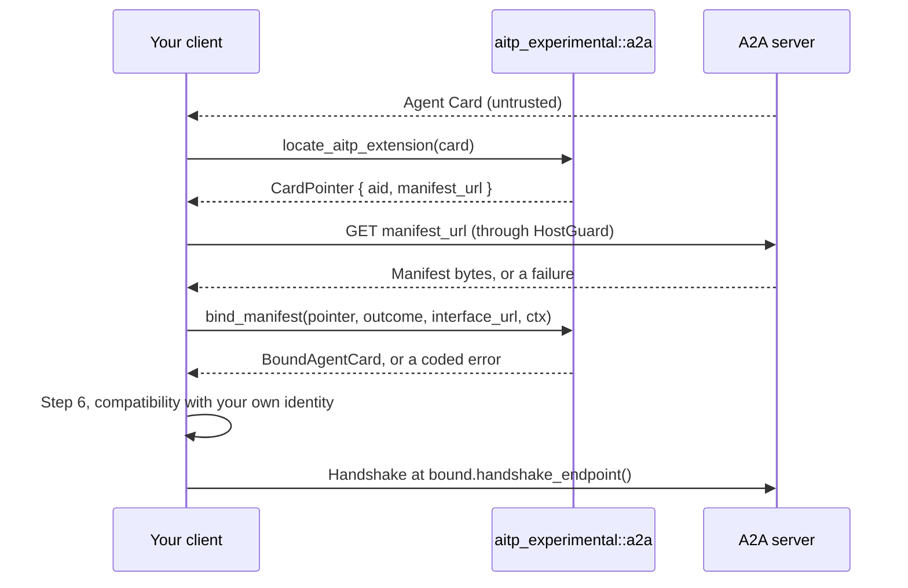

# A2A Agent Card binding (RFC-AITP-0014)

> **Status: opt-in, tracks a Draft RFC.**
> [RFC-AITP-0014](https://github.com/agentidentitytrustprotocol/agentidentitytrustprotocol/blob/main/rfcs/RFC-AITP-0014-a2a-agent-card.md)
> is **Draft**. It is not part of v0.3 core conformance; its fixtures
> (`a2a-*`) carry the runner feature `aitp-a2a-agent-card`. In `aitp-rs` it
> lives in the `aitp-experimental` crate, module `aitp_experimental::a2a`,
> behind feature `a2a-agent-card`. There is no stability promise.

An A2A Agent Card says where an agent is. It is not evidence of who the
agent is. Under this binding the Card names an AID and a Manifest URL, and
the agent's own signed Manifest then has to confirm the AID and list the
A2A interface the client intends to call. Only then may that interface
receive a TCT.

## What is implemented

| RFC section | Here |
|---|---|
| §4.2 steps 1 to 5, client verification | `locate_aitp_extension`, `bind_manifest`, `verify_agent_card_binding` |
| §4.3, effective values come from the Manifest | `BoundAgentCard` exposes the Manifest's values and none of the Card's |
| §6, error mapping for steps 2 to 5 | `A2aBindingError::code()` |
| §4.2 steps 6 and 7, §5.1, the client side of §5.3 | Yours. See [What stays with you](#what-stays-with-you) |
| §5.2, server verification, and A2A request headers | **Not implemented** |

Verification is pure. The module does no I/O and adds no dependency to
`aitp`.

## The flow

The Manifest URL comes out of the Card, so binding takes two calls with your
fetch between them:



```rust,ignore
use aitp::core::Timestamp;
use aitp_experimental::a2a::*;

let pointer = locate_aitp_extension(&card)?;
let body = fetch(pointer.manifest_url());
let outcome = match &body {
    Some(bytes) => ManifestFetch::Fetched(bytes),
    None => ManifestFetch::Unreachable,
};
let bound = bind_manifest(
    &pointer,
    outcome,
    "https://b.agents.example.com/a2a/v1",
    &BindingContext::at(Timestamp::now()),
)?;
let endpoint = bound.handshake_endpoint();
```

`verify_agent_card_binding` is the single call for a caller that already holds
the Manifest bytes, and `ManifestFetch::Verified` takes a Manifest you verified
earlier (§4.2 step 3). `BindingContext::with_expected_aid` adds a configured
AID pin (§4.2 step 4).

The interface URL is the `url` of the AgentInterface you intend to call. It is
matched byte for byte against the Manifest's
`extensions["rfc-aitp-0014.a2a_interfaces"]`, with no normalization.

## What stays with you

- **Fetching.** `manifest_url` is chosen by whoever wrote the Card. Fetch it the
  way you fetch any untrusted URL, through `HostGuard` (`aitp::transport`) or an
  equivalent, and pass `ManifestFetch::Unreachable` on a non-2xx, DNS, TLS or
  network failure.
- **Step 6, compatibility.** It needs your own identity. An OIDC client checks
  that `bound.accepted_trust_anchors()` overlaps its own. Any other client calls
  `aitp::manifest::check_identity_type_compatibility`.
- **Step 7, the handshake.** Run it against `bound.handshake_endpoint()`, never a
  URL from the Card.
- **§5.1, presenting the TCT.** Send it in `AITP_TCT_HEADER` over TLS, list
  `AITP_A2A_EXTENSION_URI` in `A2A-Extensions`, and send only the TCT this bound
  server issued.
- **§5.3, proof of possession.** A server that requires it rejects the first
  request and returns a base64url-encoded `pop_challenge` envelope in
  `x-aitp-pop-challenge`. Repeat the request with the same TCT and a
  base64url-encoded `pop_response` envelope in `x-aitp-pop-response`.
- **§4.3 and §9.3, Card text.** Treat it, including `description` and skill names,
  as untrusted content, and never as an authorization statement.
- **§4.4, Card signatures.** A Card signature never stands in for this binding. An
  unsigned Card that binds is bound.

A plain-HTTP endpoint never binds. The binding takes no
`with_insecure_localhost_dangerous` opt-in.

## Errors

| Failure | Code |
|---|---|
| Card has no single usable AITP extension, or a `manifestUrl` that is not HTTPS (step 2) | `IDENTITY_FAILED` |
| Manifest could not be retrieved (step 3) | `MANIFEST_NOT_FOUND` |
| Manifest fails RFC-AITP-0003 §5 (step 3) | That section's codes, such as `MANIFEST_INVALID` or `MANIFEST_EXPIRED` |
| Manifest's AID differs from the Card's or from a pin (step 4) | `IDENTITY_FAILED` |
| The interface is not listed in the Manifest (step 5) | `IDENTITY_FAILED` |

## SDKs

A source build of either SDK with feature `experimental-a2a-agent-card` adds the
same two steps. The published packages do not include it. See
[sdk-python.md](sdk-python.md) and [sdk-node.md](sdk-node.md).

## Conformance

```bash
./target/debug/aitp-conformance run --target ./target/debug/aitp-rs-adapter \
  --fixtures-dir ../agentidentitytrustprotocol/schemas/conformance \
  --feature aitp-a2a-agent-card
```

Fixtures `a2a-001` to `a2a-006` cover it. See [conformance.md](conformance.md).
