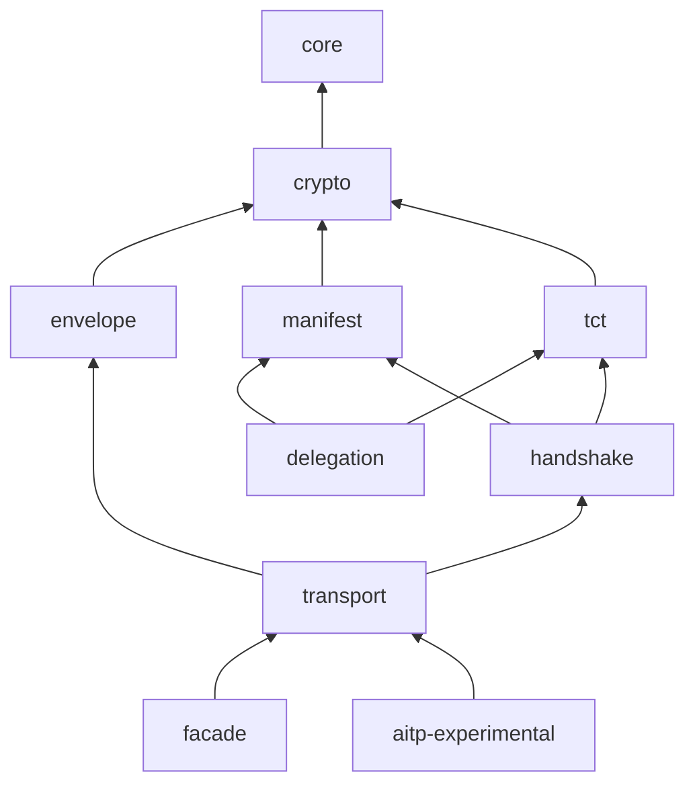

# Architecture

A reading guide for someone picking up `aitp-rs` for the first time.

`aitp-rs` is the Rust reference implementation of the
[Agent Identity & Trust Protocol](https://github.com/agentidentitytrustprotocol/agentidentitytrustprotocol)
(AITP). AITP is a JSON-only, A2A (agent-to-agent) trust protocol:
two agents perform a Mutual Handshake, exchange signed Trust
Context Tokens (TCTs), and then invoke each other's capabilities
under those TCTs.

This workspace tracks **AITP v0.3** (protocol version literal
`aitp/0.3`). AITP signs its artifacts under two profiles: the portable
trust artifacts (TCT, grant voucher, delegation token) are RFC 7515
compact JWS, and the protocol-internal artifacts stay on the JCS
embedded-signature profile. The protocol side of that split is in the
spec's [architecture overview §2.1](https://github.com/agentidentitytrustprotocol/agentidentitytrustprotocol/blob/main/docs/architecture.md#21-two-signing-profiles);
which `aitp-rs` code implements each profile is in the
[table below](#the-two-signing-profiles).

This document covers the topology — what the pieces are and how they
fit — and then the rationale for why the library is layered the way it
is. For the deeper, topic-specific dives, see the sibling docs:
[`jcs.md`](jcs.md), [`handshake-transcripts.md`](handshake-transcripts.md),
and [`conformance.md`](conformance.md).

## The signed wire types

Every AITP interaction reduces to producing and verifying a signed
artifact. Each has its own RFC, JSON Schema, and a module of `aitp`.

| Type | RFC | Module | Purpose |
|---|---|---|---|
| **Manifest** | [RFC-AITP-0003](https://github.com/agentidentitytrustprotocol/agentidentitytrustprotocol/blob/main/rfcs/RFC-AITP-0003-manifest.md) | [`aitp::manifest`](../crates/aitp/src/manifest) | Self-description an agent publishes at `/.well-known/aitp-manifest`: which handshake endpoint to hit, which identity provider it uses, which capabilities it offers/requires |
| **TCT (Trust Context Token)** | [RFC-AITP-0005](https://github.com/agentidentitytrustprotocol/agentidentitytrustprotocol/blob/main/rfcs/RFC-AITP-0005-tct.md) | [`aitp::tct`](../crates/aitp/src/tct) | A signed, audience-bound, capability-scoped grant. Each peer holds the TCT issued to it by its counterpart |
| **Grant voucher** | [RFC-AITP-0005 §8](https://github.com/agentidentitytrustprotocol/agentidentitytrustprotocol/blob/main/rfcs/RFC-AITP-0005-tct.md) | [`aitp::tct`](../crates/aitp/src/tct) | A companion artifact the TCT issuer mints alongside the TCT (same handshake commit). Lets the subject delegate without anyone reconstructing TCT bytes; replaces the v0.1 `grant_proof` mechanism |
| **Delegation token** | [RFC-AITP-0006](https://github.com/agentidentitytrustprotocol/agentidentitytrustprotocol/blob/main/rfcs/RFC-AITP-0006-delegation.md) | [`aitp::delegation`](../crates/aitp/src/delegation) | Single-hop subdelegation: B holds A's TCT + voucher, issues a derived token to C with a subset of grants, embedding A's voucher verbatim |
| **Revocation snapshot** | [RFC-AITP-0008](https://github.com/agentidentitytrustprotocol/agentidentitytrustprotocol/blob/main/rfcs/RFC-AITP-0008-revocation.md) | [`aitp::tct::revocation`](../crates/aitp/src/tct/revocation.rs) | Periodically-refreshed signed list of revoked TCT JTIs. An empty list is also signed — defends against suppression of fresher snapshots |

### The two signing profiles

The profiles themselves (wire form, signing input, the boundary rule, the
`alg`/`typ` pinning) are defined in
[RFC-AITP-0001 §5.4](https://github.com/agentidentitytrustprotocol/agentidentitytrustprotocol/blob/main/rfcs/RFC-AITP-0001-core.md) and explained in
the spec's [architecture overview §2.1](https://github.com/agentidentitytrustprotocol/agentidentitytrustprotocol/blob/main/docs/architecture.md#21-two-signing-profiles)
and the [Implementer Quickstart](https://github.com/agentidentitytrustprotocol/agentidentitytrustprotocol/blob/main/docs/implementer-quickstart.md#two-signing-profiles).
This is where each one lives in `aitp-rs`:

| Profile | Shared machinery | Artifacts and their modules |
|---|---|---|
| **Compact JWS** (RFC-AITP-0001 §5.4.5) | `aitp::crypto::jws` (`crates/aitp/src/crypto/jws.rs`): strict compact parsing, `alg` derived from the signer's AID, exact `typ` match (`TOKEN_ALG_MISMATCH` / `TOKEN_TYP_MISMATCH`) | TCT and grant voucher: `aitp::tct`. Delegation token: `aitp::delegation` |
| **JCS embedded-signature** (RFC-AITP-0001 §5.4.1) | `aitp::core::jcs` (canonicalization) + `aitp::crypto` (Ed25519 / P-256 signing); see [`jcs.md`](jcs.md) | Envelope: `aitp::envelope`, over the domain-tagged `aitp-envelope-v2` input (`aitp::core::envelope_signing_input`, RFC-AITP-0001 §5.4). Manifest: `aitp::manifest`. Revocation snapshot: `aitp::tct::revocation`. Session-bundle outer signature: `aitp_experimental::session_bundle`. Handshake payloads: `aitp::handshake::payloads` |

Both profiles support Ed25519 and P-256 (ES256) in every module above.

### Debugging a TCT

Because a TCT (and the grant voucher, and a delegation token) is now an
ordinary compact JWS, you can decode and verify it with no AITP tooling
at all:

- Paste the compact string into [jwt.io](https://jwt.io) to inspect the
  header and claims.
- Verify it programmatically with any JOSE library — node
  [`jose`](https://github.com/panva/jose), python
  [`PyJWT`](https://pyjwt.readthedocs.io/) — supplying the issuer's
  public key. The key is derivable from the issuer AID (`iss`): the AID
  *is* the base64url public key (or its `p256:` variant), and `cnf.jkt`
  is the RFC 7638 thumbprint of the subject key.

The claims you'll see on a TCT are the registered JWT names
`ver, jti, iss, sub, aud, iat, exp` plus the private `grants` array,
the RFC 7800 `cnf` confirmation claim (`jkt` member) and an optional
`ext` object (`TctClaims` in `crates/aitp/src/tct/types.rs`).

## The four-message handshake

The exchange (`MUTUAL_HELLO`, `MUTUAL_HELLO_ACK`, `MUTUAL_COMMIT`,
`MUTUAL_COMMIT_ACK`) is defined in
[RFC-AITP-0004](https://github.com/agentidentitytrustprotocol/agentidentitytrustprotocol/blob/main/rfcs/RFC-AITP-0004-mutual-handshake.md) and walked
through in the spec's
[architecture overview §3.2](https://github.com/agentidentitytrustprotocol/agentidentitytrustprotocol/blob/main/docs/architecture.md#32-mutual-handshake).
In `aitp-rs` it is split across three layers:

| Layer | Where | What it does |
|---|---|---|
| State machines | `aitp::handshake` (`crates/aitp/src/handshake/state_machine.rs`: `Initiator`, `Responder`) | Sync, no I/O. Build and verify each message; identity proofs in `identity_pinned.rs` / `identity_oidc.rs`; issue the peer TCT and grant voucher through `aitp::tct` |
| HTTP binding | `aitp::transport` (`HandshakeServer`, `ManifestFetcher`) | Serve the responder side and fetch the peer Manifest over SSRF-guarded HTTPS |
| One-call driver | `aitp::facade::run_initiator_handshake` (async) | Runs the initiator side end to end against a peer's handshake endpoint |

For the bytes on the wire, see
[`handshake-transcripts.md`](handshake-transcripts.md).

## Crate map

Three crates are published: `aitp` (the protocol library, one module per
layer), `aitp-experimental` (no stability promise) and `aitp-cli`.

```
aitp                       the protocol library (crates/aitp)
├── core                   primitives: Aid, JCS, base64url, Timestamp,
│                          ExtensionsMap, AitpEnvelope, ErrorCode
├── crypto                 Ed25519 (verify_strict) + P-256/ES256
│                          (canonical low-S) + compact JWS + JWK thumbprint
├── envelope               sign_envelope + verify_envelope_signature —
│                          sync, no I/O
├── manifest               ManifestBuilder + verify_manifest
├── tct                    TctBuilder + verify_tct + PoP exchange +
│                          revocation snapshots + renewal (feature-gated)
├── delegation             DelegationBuilder + verify_delegation
│                          (single-hop; multi-hop chains opt-in at runtime)
├── handshake              Initiator/Responder state machines, OIDC
│                          and pinned-key identity proofs, RSA-2048 floor
│                          on OIDC RSA keys
├── transport              ManifestServer + HandshakeServer (axum,
│                          http-server) + ManifestFetcher + JwksFetcher
│                          (reqwest, http-client), RSA-2048 floor on JWKS keys
├── facade                 async run_initiator_handshake / renew_tct +
│                          TctStore (http-client)
└── prelude                the most common types

aitp-experimental          session_bundle: SessionBundleBuilder +
                           verify_session_bundle (RFC-0010), plus
                           SessionBundleServer (http-server feature)
aitp-cli                   `aitp` binary — offline keygen / aid /
                           tct inspect+verify / manifest verify;
                           manifest fetch + handshake (http-client)
aitp-conformance           runner + Adapter trait + SubprocessAdapter
(unpublished)              + InProcessRustAdapter, and the
                           `aitp-rs-adapter` binary (rs_adapter module),
                           Tier A/B/C/D

bindings/aitp-py           Python SDK (PyO3)     — excluded from the workspace
bindings/aitp-node         Node.js SDK (NAPI-rs) — excluded from the workspace
bindings/interop           cross-language interop tests — `make interop`

examples/two-agents        end-to-end demo — `make demo`
tools/mint-signed-examples       mint signed artifacts from spec KAT seeds
tools/mint-conformance-fixtures  walk spec fixtures, substitute placeholders
```

The tree shows what each crate contains, not a dependency chain. The
dependency edges between the modules of `aitp` (from their `use crate::…`
imports) are:

- `core` depends on no other module.
- `crypto` depends on `core`.
- `envelope`, `manifest` and `tct` depend on `core` + `crypto`.
- `delegation` depends on `core` + `crypto` + `manifest` + `tct`.
- `handshake` depends on `core` + `crypto` + `manifest` + `tct`.
- `transport` depends on `core` + `crypto` + `envelope` + `manifest` +
  `handshake` + `tct`. It does not depend on `delegation`.
- `facade` depends on `transport` and the protocol modules it drives.
- `aitp-experimental` depends on `aitp` (`default-features = false`);
  its `http-server` feature turns on `aitp/http-server`.



The protocol modules are sync. Async code lives in `aitp::transport`
(behind the `http-client` / `http-server` features) and in
`aitp::facade`'s `run_initiator_handshake` and `renew_tct`.

## Why the library is layered this way

The layering is load-bearing — it exists to serve three audiences with
different needs from one codebase:

1. **TCT-only consumers** (e.g. the MACP runtime) want to verify TCTs and
   nothing else — no HTTP client, no handshake server, no OIDC JWT
   library.
2. **Standalone agents** want the full handshake, TCT exchange, manifest
   fetch, and HTTP serving behind a one-line dependency.
3. **The conformance runner** needs an in-process adapter that can call
   into every layer.

One crate serves all three because the heavy dependencies sit behind
features and the module boundaries below stay one-directional:

- **`aitp::core` has no crypto.** Wire types, JCS, base64url, AID parsing —
  usable by anything that handles AITP data (storage, logging, analysis).
- **`aitp::crypto` has no protocol.** It wraps `ed25519-dalek` and `p256`
  with AITP key handling, implements the compact-JWS profile and the JWK
  thumbprint; it does not know what a Manifest or TCT is.
- **`aitp::envelope` is the sync envelope codec.** `sign_envelope` /
  `verify_envelope_signature` depend only on `core` + `crypto` — no HTTP,
  no async — so the language bindings (and other sync consumers) can
  sign/verify without a transport stack; `aitp::transport::common` keeps
  thin wrappers over it.
- **`aitp::tct` does not depend on `aitp::handshake`.** TCT verification is
  the per-request hot path and must not reach into the state machine.
  `handshake` depends on `tct` + `manifest` — it issues TCTs and verifies
  Manifests, so that direction is correct.
- **`aitp::transport` is feature-gated and is where the HTTP lives.**
  `http-client` pulls `reqwest`, `http-server` pulls `axum`. No protocol
  module depends on it, so a consumer on a different transport (gRPC,
  MessagePack) builds `aitp` with `default-features = false`, implements
  just the wire layer and reuses every protocol module.
- **`aitp::facade` and `aitp::prelude`** add the async
  `run_initiator_handshake` helper (plus `renew_tct` behind
  `experimental-renewal`) on top (`http-client` feature, on by default).
  This is what most users call. A TCT-only consumer uses `aitp::tct` +
  `aitp::crypto` from `aitp` with `default-features = false`.
- **Session Trust Bundles are a separate crate.** `aitp-experimental`
  carries the Draft RFC-0010 surface with no semver promise, so it can
  change without a breaking release of `aitp`.
- **The conformance runner and the Rust adapter share an unpublished
  crate.** The runner is language-agnostic; the adapter
  (`aitp_conformance::rs_adapter`, the `aitp-rs-adapter` binary) is
  `aitp-rs`-specific, and other-language adapters speak to the same
  runner over NDJSON.

### Async story

The protocol modules are sync. Async code lives in `aitp::transport`
(because `reqwest` / `axum` are) and in `aitp::facade`'s
`run_initiator_handshake` and `renew_tct`, which drive it. This keeps TCT
verification callable from sync codebases and from non-Rust runtimes via
FFI: the language bindings build `aitp` with `default-features = false`
and call the protocol modules directly, not the facade.

## Why multi-hop delegation is unreachable by default

Until a verifier opts into RFC-AITP-0011, the multi-hop guard in
[RFC-AITP-0006 §4](https://github.com/agentidentitytrustprotocol/agentidentitytrustprotocol/blob/main/rfcs/RFC-AITP-0006-delegation.md) requires it to
reject any delegation token carrying a `chain` claim with
`DELEGATION_MULTIHOP_NOT_SUPPORTED`. A chain also widens what the verifier
must get right: per-hop signatures, issuer/subject continuity, transitive
scope subsetting, `chain_hash` truncation defence, per-hop revocation and a
hop limit against verification DoS
([RFC-AITP-0011 §9](https://github.com/agentidentitytrustprotocol/agentidentitytrustprotocol/blob/main/rfcs/RFC-AITP-0011-multihop-delegation.md)).
The grant voucher inside `chain[0]` also discloses the root grant
profile to every later hop. A deployment that never asked for chains should not carry that surface.

So the multi-hop code is in the `aitp-experimental` crate
(`aitp_experimental::delegation`), not in `aitp`. The stable
`aitp::delegation::verify_delegation` rejects a `chain` claim before any
other claim check, and rejects the multi-hop `jti` and `chain_hash` claims
(`crates/aitp/src/delegation/verifier.rs`). Chains verify only through
`aitp_experimental::delegation::verify_chained_delegation`. The
language bindings follow the same rule: `verify_delegation` /
`verifyDelegation` stays strict,
and chains need the separate `verify_delegation_multihop` /
`verifyDelegationMultihop` call. Details: [`multihop-delegation.md`](multihop-delegation.md).

## Workspace conventions

- **Workspace deps only.** Every third-party crate is pinned once in the
  root `[workspace.dependencies]` and referenced via `{ workspace = true }`,
  so the lock holds exactly one version of each — upgrades are one-line.
- **MSRV 1.90**, in lockstep with the `1.90.0` toolchain pin in
  `rust-toolchain.toml`. MSRV rose from 1.75 once transitive deps
  (`time`, `icu_*`, `idna_adapter`, `clap_lex`) began requiring
  edition 2024, then from 1.89 to 1.90 when `metrics-util` 0.20
  pulled in `ordered-float` 5.5.0; `cargo msrv verify` gates it in CI.
- **Dual MIT OR Apache-2.0** — standard Rust convention (same as `tokio`,
  `serde`, `tower`), friendlier to enterprise adoption than either alone.
- **`#![forbid(unsafe_code)]`** on every library root under `crates/`
  (`src/lib.rs`). It is **not** set on the separate binary roots
  `crates/aitp-cli/src/main.rs`, `crates/aitp-conformance/src/main.rs` and
  `crates/aitp-conformance/src/bin/aitp-rs-adapter.rs`, on
  `examples/two-agents` (library and bins), or on the `tools/*` binaries. The binding crates omit it on
  purpose: the PyO3 / NAPI-rs export macros expand to `unsafe` glue.
  **`#![warn(missing_docs)]`** is set on `aitp` and
  `aitp-experimental`.

## What's anchored to the spec, not just self-consistent

A common failure mode for early protocol implementations is
"works against itself, fails against any other implementation."
Five test families pin `aitp-rs` against spec-published reference
values rather than its own output:

- **Keypair derivation** (`crates/aitp/tests/crypto_kat.rs`) —
  seed → pubkey → AID for every pinned keypair (Ed25519 and P-256)
- **JWK thumbprints** (same file) — RFC 7638 thumbprints for the
  pinned keypairs (also the `cnf.jkt` value on a v0.2 TCT)
- **JCS + SHA-256** (`crates/aitp/tests/core_kat.rs`) — canonical
  bytes and SHA-256 digest of the **JCS-profile** artifacts (Manifest,
  revocation snapshot, session bundle). The v0.1 TCT and delegation JCS vectors are
  retired with the move to compact JWS.
- **Compact-JWS vectors** (`tests/schemas/known-answer/signed-examples/`,
  checked by `crates/aitp/tests/crypto_jws_kat.rs` and
  `crates/aitp/tests/tct_kat.rs`) — the pinned TCT, grant voucher, and
  delegation tokens; verified over their exact transmitted bytes, not
  reconstructed.
- **Revocation snapshot** (`crates/aitp/src/tct/revocation.rs::rfc_kat_canonical_bytes_match`)
  — canonical bytes byte-for-byte against `kat-revocation-001`

If any of these break, the implementation has drifted from the
spec — investigate before touching the test.

## How the schemas stay honest

[`tests/schemas/`](../tests/schemas) is a vendored copy of the spec
repo's JSON schemas, pinned to a specific spec commit by the
[`SPEC_VERSION`](../tests/schemas/SPEC_VERSION) file. A CI job
(`spec-schemas` in [`.github/workflows/ci.yml`](../.github/workflows/ci.yml))
re-runs [`scripts/sync-schemas.sh`](../scripts/sync-schemas.sh)
against the pinned commit and fails if the vendored copies have
drifted. The per-module `crates/aitp/tests/*_schema.rs` files validate
fully-populated wire types against those schemas. Together the firewall catches
the class of drift where Rust types and spec schemas accidentally
diverge.

When the spec moves, the workflow is:

1. Re-run `scripts/sync-schemas.sh` (pulls new schemas and KAT
   vectors into `tests/schemas/`)
2. Schema tests fail with a precise diagnostic about the new field
3. Fix the Rust types
4. Update `SPEC_VERSION`
5. Commit

## Conformance

[`aitp-conformance`](../crates/aitp-conformance) defines the runner and the
`Adapter` trait. Two adapters ship: `SubprocessAdapter` (speaks NDJSON over
stdin/stdout to any binary that implements the protocol — the
`aitp-rs-adapter` binary ([`rs_adapter`](../crates/aitp-conformance/src/rs_adapter))
is the Rust one) and `InProcessRustAdapter` (calls `aitp` directly, for
fast local dev). The
op vocabulary spans four tiers — verification, issuance, stateful flows,
and test-only.

A cross-language adapter need only implement that NDJSON protocol; the
runner, fixtures, and assertion machinery are shared. The full wire
protocol, the per-tier op table, and the live fixture matrix all live in
[`conformance.md`](conformance.md).

## Language bindings

[`bindings/aitp-py`](../bindings/aitp-py) (PyO3) and
[`bindings/aitp-node`](../bindings/aitp-node) (NAPI-rs) are thin SDKs
over `aitp` — an `AitpAgent` plus initiator/responder
session types whose methods take and return JSON strings (the HTTP
request/response bodies), so agent code never handles a Rust type.
Both depend on `aitp` with `default-features = false` (plus
`aitp-experimental` for session bundles) and call `aitp::envelope`
directly, so a binding can sign and verify envelopes without an HTTP
stack.

The bindings are **excluded from the Cargo workspace** — they are
`cdylib`s built by maturin / napi-cli against an external toolchain.
Each SDK has its own in-process handshake tests
([`aitp-py/tests`](../bindings/aitp-py/tests),
[`aitp-node/tests`](../bindings/aitp-node/tests)).
[`bindings/interop`](../bindings/interop) goes further: it runs a real
four-message handshake *between* the two SDKs, in both directions, to
prove they emit wire-compatible envelopes. `make interop` builds both
bindings and runs that suite.

## Where to read further

- [`jcs.md`](jcs.md) — JSON canonicalization strategy, test vectors, the
  surrogate-pair history
- [`conformance.md`](conformance.md) — the full NDJSON adapter protocol
  and the per-fixture matrix
- [`handshake-transcripts.md`](handshake-transcripts.md) — the four-message
  exchange, byte by byte
- [`session-bundle.md`](session-bundle.md),
  [`multihop-delegation.md`](multihop-delegation.md),
  [`tct-renewal.md`](tct-renewal.md) — the opt-in extensions (RFC-0010 and
  RFC-0011 and RFC-0013 are Draft)
- [`sdk-python.md`](sdk-python.md) / [`sdk-node.md`](sdk-node.md) and
  [`transport-hardening.md`](transport-hardening.md) — SDK guides and the
  HTTP-transport hardening register
- [`../CHANGELOG.md`](../CHANGELOG.md) — release history and current direction
- The [AITP RFCs](https://github.com/agentidentitytrustprotocol/agentidentitytrustprotocol/tree/main/rfcs)
  themselves — the protocol is normatively defined there; this
  implementation tracks them

## Where to start reading the code

- New to AITP and want to understand what a handshake produces?
  Read [`crates/aitp/src/handshake/state_machine.rs`](../crates/aitp/src/handshake/state_machine.rs)
- Want to see end-to-end usage in ~250 lines?
  Read [`examples/two-agents/`](../examples/two-agents) or run
  `make demo`
- Writing an adapter in another language? Read
  [`conformance.md`](conformance.md) and look at
  [`crates/aitp-conformance/src/rs_adapter/mod.rs`](../crates/aitp-conformance/src/rs_adapter/mod.rs)
  for a working reference
- Curious about a specific signed wire type? Each
  `crates/aitp/src/<module>/types.rs` has rustdoc plus
  `crates/aitp/tests/<module>_round_trip.rs` showing the full lifecycle
