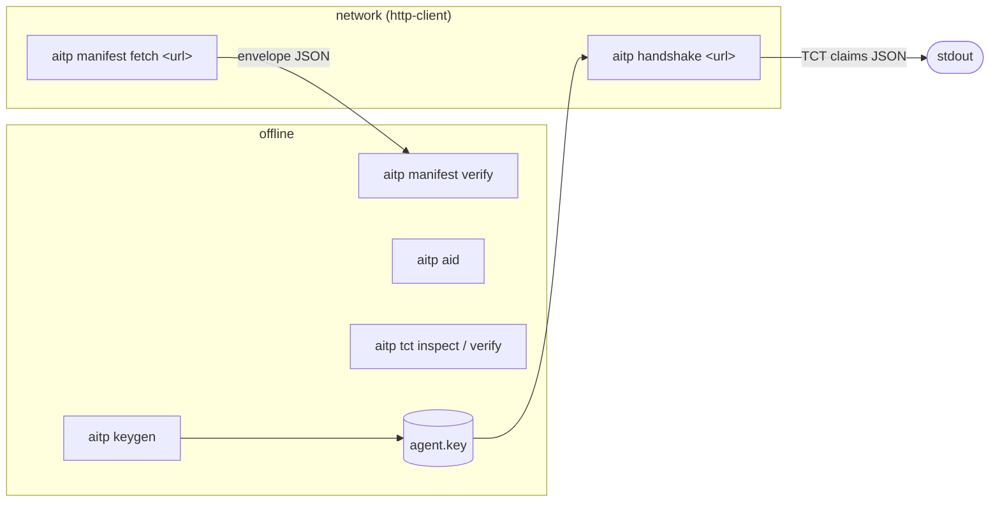

# The `aitp` CLI

`aitp` is the command-line tool for AITP, shipped as the `aitp-cli`
crate. It covers what you reach for while building or debugging an
integration:

- **Offline commands:** generate a key, derive an AID, inspect or verify
  a TCT, and verify a Manifest. These never touch the network.
- **Networked commands:** fetch and verify a peer's Manifest, or run the
  full four-message handshake against a peer and print the TCT it issues
  you. They are behind the `http-client` feature, which is on by default.



## Install

```bash
cargo install aitp-cli      # installs the `aitp` binary
aitp --version
```

Each release also attaches prebuilt binaries to its `aitp-cli-v<version>`
[GitHub Release](https://github.com/agentidentitytrustprotocol/aitp-rs/releases),
each with a `.sha256` file:

| Target | Archive |
|---|---|
| Linux x86_64 | `aitp-<version>-x86_64-unknown-linux-gnu.tar.gz` |
| Linux arm64 | `aitp-<version>-aarch64-unknown-linux-gnu.tar.gz` |
| macOS Apple silicon | `aitp-<version>-aarch64-apple-darwin.tar.gz` |
| macOS Intel | `aitp-<version>-x86_64-apple-darwin.tar.gz` |
| Windows x86_64 | `aitp-<version>-x86_64-pc-windows-msvc.zip` |

`aitp-cli` is versioned in lockstep with the library crates, so
`aitp 0.23.0` speaks the same protocol as `aitp = "0.23.0"`.

For the offline commands only, without the HTTP stack:

```bash
cargo install aitp-cli --no-default-features
```

From a checkout, use `cargo run -p aitp-cli -- <command>`.

## Handshake with a peer

```bash
aitp keygen > agent.key                       # once: a persistent identity
aitp handshake https://peer.example \
  --key agent.key \
  --grant demo.echo \
  --offer demo.echo
```

`aitp handshake <url>` runs the Mutual Handshake (RFC-AITP-0004) as
initiator over HTTP:

1. It fetches and verifies `<url>/.well-known/aitp-manifest`
   (RFC-AITP-0003).
2. It sends MUTUAL_HELLO and checks the peer's MUTUAL_HELLO_ACK.
3. It issues the peer a TCT and sends COMMIT.
4. It verifies the TCT the peer returns in COMMIT_ACK, including its
   revocation status (RFC-AITP-0008, `fail_closed`).

On success it prints the verified claims of the TCT the peer issued you,
as JSON on stdout, and exits 0. Progress notes go to stderr, so stdout
pipes cleanly:

```console
$ aitp handshake https://peer.example --key agent.key --grant demo.echo --offer demo.echo
aitp: trusting peer aid:pubkey:4v4q… from its Manifest (trust on first use; pass --peer-aid to pin it)
aitp: handshake complete with aid:pubkey:4v4q…
{
  "iss": "aid:pubkey:4v4q…",
  "sub": "aid:pubkey:W2SJ…",
  "aud": "aid:pubkey:W2SJ…",
  "grants": ["demo.echo"],
  …
}
```

### Options

| Option | Meaning |
|---|---|
| `--key <FILE>` | Present this signing key. The file is `aitp keygen` output (its `suite:` line picks the suite) or a bare 64-hex-char seed. |
| `--ephemeral` | Present a throwaway Ed25519 key for this run. Exactly one of `--key` / `--ephemeral` is required. |
| `--suite ed25519\|p256` | Suite of a bare-seed `--key` file (default `ed25519`). |
| `--grant <CAP>` | Capability to request from the peer. Repeatable. |
| `--offer <CAP>` | Capability to offer the peer. Repeatable; see below. |
| `--peer-aid <AID>` | Pin the peer. Without it, the AID in the peer's Manifest is trusted on first use. |
| `--revocation-fail-open` | Accept a peer whose revocation list cannot be fetched or verified. Default: refuse it. |
| `--timeout <SECS>` | Per-request HTTP timeout (default 10). |
| `--insecure-localhost` | Allow a plain `http://localhost` / `http://127.0.0.1` peer. For local development only: RFC-AITP-0003 §4.1 requires HTTPS. |

**The handshake is mutual.** The peer gets a TCT from you as well. That
TCT grants the capabilities the peer requests that you `--offer`, and an
empty intersection fails the handshake with `POLICY_VIOLATION`
(RFC-AITP-0004 §4.1). The CLI runs no service, so the TCT it issues
authorizes nothing in practice, but you still have to offer what the peer
asks for.

**Peer trust.** The CLI presents a pinned-key identity and verifies the
peer as a pinned-key peer (RFC-AITP-0002 §3). The peer's Manifest is
self-signed by the AID it names, so without `--peer-aid` the CLI trusts
whichever key answers at `<url>` and says so on stderr. Pass `--peer-aid`
to refuse anyone else. OIDC- and SPIFFE-identity peers aren't supported
by the CLI yet; use the library for those.

### Failures and exit status

Every failure exits 1, prints nothing on stdout, and prints one
`aitp: error: …` line on stderr. When the failure has a registered AITP
error code, it comes first, so a script can match on it:

```console
$ aitp handshake https://peer.example --ephemeral --grant demo.echo --offer demo.echo
aitp: error: IDENTITY_FAILED: peer rejected the handshake: …
hint: the peer does not trust this ephemeral key. A peer that pins keys must enrol yours first: …
```

| Code | Typical cause | Hint printed |
|---|---|---|
| `IDENTITY_FAILED` from the peer, with `--ephemeral` | The peer pins keys and has never seen this one. | Create a persistent key with `aitp keygen`, have the peer enrol its AID (e.g. through its `/enroll` endpoint), and rerun with `--key`. |
| `POLICY_VIOLATION` from the peer | You requested nothing the peer offers. | Request one of its `offered_capabilities` with `--grant` (list them with `aitp manifest fetch`). |
| `POLICY_VIOLATION` raised locally | The peer requested nothing you `--offer`. | Offer what it requests with `--offer`. |
| `IDENTITY_FAILED` raised locally | The peer is not the `--peer-aid` you pinned, or its proof failed. | — |
| `TCT_REVOKED` | The peer's revocation list is unreachable or invalid (`fail_closed`), or your TCT is revoked. | — |
| `INCOMPATIBLE_IDENTITY_TYPE` | The peer does not accept `pinned_key` identities. | — |

Transport failures carry no code: an unreachable host, a TLS error, a
plain-`http` URL without `--insecure-localhost`, or a non-AITP HTTP
error:

```console
$ aitp handshake https://down.example --ephemeral
aitp: error: manifest fetch failed: network error: error sending request for url (https://down.example/.well-known/aitp-manifest)
```

Command-line usage errors exit 2 (clap's convention).

## Fetch a Manifest

```bash
aitp manifest fetch https://peer.example
```

This fetches `<url>/.well-known/aitp-manifest`, verifies its signature
and proof of possession, and prints the envelope (`{"manifest": {…}}`).
That is the shape `aitp manifest verify` reads, so you can save a
Manifest and check it again later:

```bash
aitp manifest fetch https://peer.example > peer.json
aitp manifest verify --file peer.json
```

`--timeout` and `--insecure-localhost` work as for `handshake`.

## Network behaviour

Both networked commands use the `aitp` facade's hardened HTTP client
(see [transport-hardening.md](transport-hardening.md)):

- **TLS** is rustls with the Mozilla root set from `webpki-roots`. The OS
  trust store is not consulted, so a private CA isn't trusted.
- **Proxies.** `HTTPS_PROXY`, `HTTP_PROXY`, `ALL_PROXY` and `NO_PROXY`
  (and their lowercase forms) are honoured. The SSRF guard still resolves
  the peer's host name locally before connecting, so DNS must work from
  where the CLI runs.
- **SSRF guard.** Redirects are refused. Link-local and cloud-metadata
  addresses are always refused. Private ranges are allowed.

## Offline commands

```text
aitp keygen [--suite ed25519|p256] [--seed <hex>]
aitp aid --seed <hex> [--suite ...]
aitp tct inspect --token <jws|->
aitp tct verify --token <jws|-> [--issuer <aid>] [--audience <aid>] [--at <unix>]
aitp manifest verify [--file <path|->] [--at <unix>]
```

See [`crates/aitp-cli/README.md`](../crates/aitp-cli/README.md) for what
each one does. `-` reads from stdin.
