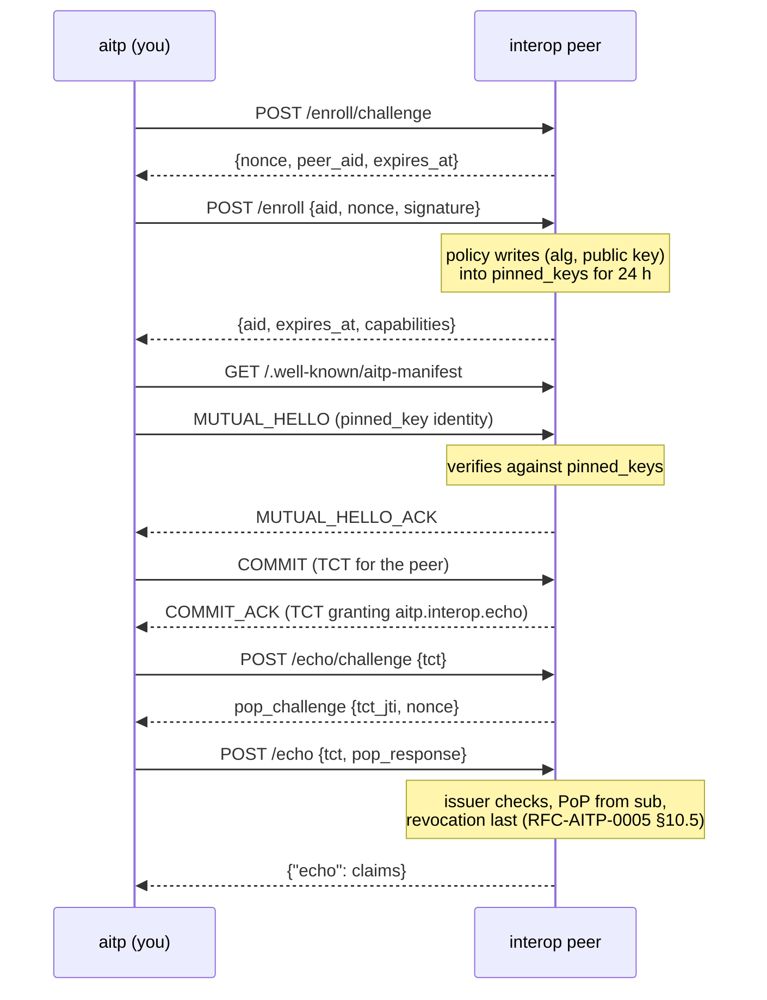
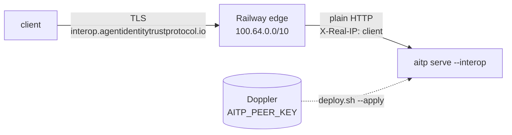

# The interop peer

The interop peer is a public AITP responder that anyone can complete a
real handshake with. It runs at
`https://interop.agentidentitytrustprotocol.io`, and it is the `aitp`
binary's own `aitp serve --interop`, so you can run a copy yourself.

```bash
cargo install aitp-cli
aitp enroll https://interop.agentidentitytrustprotocol.io
aitp echo https://interop.agentidentitytrustprotocol.io
```

The peer only accepts handshakes from keys it has pinned, so the
handshake needs your key to be *enrolled* first. `aitp enroll` does that,
using (and on first use creating) your default key. `aitp echo` then
presents the same key: it runs the handshake and hands the TCT the peer
issued back to its `/echo`, with proof of possession. See [cli.md](cli.md) for both commands.

## What it serves

| Route | What it does |
|---|---|
| `GET /.well-known/aitp-manifest` | The peer's signed Manifest (RFC-AITP-0003). |
| `POST /aitp/handshake/hello`, `/commit` | The Mutual Handshake, as responder (RFC-AITP-0004). |
| `GET /.well-known/aitp-revocation-list` | The peer's own `ListRevoked` snapshot (RFC-AITP-0008). It revokes nothing, so the list is always empty. |
| `POST /enroll/challenge`, `POST /enroll` | Key enrolment, below. |
| `POST /echo/challenge`, `POST /echo` | Present the TCT the peer issued you, with proof of possession; get its verified claims back. |
| `GET /status` | `{"status": "ok", "aid", "version", "capabilities", "enrolled"}`. |



## Enrolment is key registration

How a pinned-key responder's `pinned_keys` gets populated is operator
policy, not part of the protocol: RFC-AITP-0002 §3.2 says so, enrolment
flows included (spec commit
[`d18f1fd`](https://github.com/agentidentitytrustprotocol/agentidentitytrustprotocol/commit/d18f1fd)).
Enrolment is a registration step, like uploading an SSH public key. It
is not an AITP identity verification mode, and it is not RFC-AITP-0002
§3.4 pinned admission: the peer doesn't run the §3.4 verifier, its
responses don't claim to be §3.4, and its error codes are its own.

The caller proves it holds the private key for an AID by signing a
single-use challenge. The peer's policy then writes the key into the
pinned-key store that every handshake verifies against:

> Anyone may enrol a key, for 24 hours, for the capability
> `aitp.interop.echo` only.

There is no possession-only path: a key that isn't enrolled is refused
at MUTUAL_HELLO with `IDENTITY_FAILED`, as at any pinned-key responder.

### Wire format

```text
POST /enroll/challenge  {}                       -> 200 {nonce, peer_aid, expires_at}
POST /enroll            {aid, nonce, signature}  -> 200 {aid, expires_at, capabilities}
```

- `nonce` is 16 random bytes, base64url without padding. It is accepted
  once, for 60 seconds.
- `signature` is the AID key's signature (the suite's JCS signature,
  `sign_jcs`) over
  `SHA-256("aitp-interop-enrol-v1" 0x00 aid 0x00 peer_aid 0x00 nonce)`,
  with `nonce` as the 16 raw bytes. Binding `peer_aid` stops a signature
  made for one peer being replayed at another.
- Ed25519 and P-256 AIDs (`aid:pubkey:`) are both accepted. The response
  `aid` is the canonical form, which handshakes present.
- Unknown fields are refused.

The peer checks a request in this order: the per-address rate limit,
then the body, then the signature, then the nonce. The signature comes
before the nonce, so a forged request can't burn an honest client's
challenge. The implementation is `crates/aitp-cli/src/enrol.rs` (shared
by `aitp enroll` and the server, fuzzed by `fuzz_targets/interop_enroll.rs`)
and `crates/aitp-cli/src/serve.rs`.

### Errors

Every refusal is `{"error": "<code>", "message": "…"}`:

| Status | `error` | Cause |
|---|---|---|
| 400 | `bad_request` | Malformed JSON, AID, nonce or signature encoding. |
| 413 | `bad_request` | Body over 64 KiB (any route). |
| 401 | `bad_signature` | The signature doesn't verify under the AID's key for this peer and nonce. |
| 401 | `bad_nonce` | The challenge is unknown, already used, or expired. |
| 429 | `rate_limited` | Over the per-address limit; `Retry-After` says when to retry. |
| 503 | `enrol_busy` | Too many outstanding challenges; `Retry-After` when known. |

## Policy and limits

| Limit | Value | Setting |
|---|---|---|
| Enrolment lifetime | 24 h; enrolling again refreshes it | `--enrol-ttl` / `AITP_ENROL_TTL` |
| Enrolled keys held | 10 000; at the cap the oldest enrolment goes first | `--enrol-cap` / `AITP_ENROL_CAP` |
| `POST /enroll` per client address | A token bucket: a burst of 5, then one every 12 minutes (5 an hour). Every attempt counts, valid or not. | `--enrol-per-ip-per-hour` |
| `POST /enroll/challenge` per client address | A burst of 10, then one every 6 s | — |
| `POST /echo/challenge` and `POST /echo` per client address | Together, a burst of 10, then one every 6 s | — |
| Outstanding challenges | 10 000 enrolment and 10 000 echo | — |
| Handshake requests | RFC-AITP-0009 §3.1 defaults: 30 per source and 10 per sender AID per 60 s | — |
| Request body | 64 KiB, every route → 413 | — |
| Request deadline | 15 s → 408 | — |

A client address is the TCP peer, or the client named in
`X-Forwarded-For` when the TCP peer is a `--trusted-proxy`: the
rightmost hop that isn't itself trusted. IPv6 addresses count per /64.

Some edges append a public hop of their own that changes per request.
Railway's edge connects from `100.64.0.0/10` and sends
`X-Forwarded-For: <client>, <edge>` with a rotating `<edge>`, so the
rightmost-hop rule would key limits on the edge. It also writes the
client into `X-Real-IP`, replacing any value the client sent. Behind such
an edge, pass `--client-ip-header x-real-ip` so the limits key on that
header instead. The public instance runs with
`AITP_TRUSTED_PROXIES=100.64.0.0/10` and `AITP_CLIENT_IP_HEADER=x-real-ip`.

Enrolments, challenges and rate-limit state live in memory, so a restart
or redeploy clears them: enrol again.

## The handshake

The peer's Manifest offers `aitp.interop.echo`, accepts `pinned_key`
identities only, and advertises its revocation list. It requests
`aitp.interop.echo` from you, and grants you `aitp.interop.echo` and
nothing else. `aitp echo` requests and offers exactly that; `aitp
handshake` offers what you `--grant` unless you pass `--offer`.

The peer re-signs its Manifest every 12 hours (it is valid for 24), so a
Manifest you fetched is never used past its `expires_at`. A handshake
that straddles a re-sign fails and can be retried.

### Revocation of the TCT you issue the peer

In the handshake you issue the peer a TCT, and the peer checks its
revocation status like any verifier (RFC-AITP-0008). An `aitp` client or
a CI job usually publishes no revocation list. So the peer runs
`RevocationFailMode::FailOpenIfUnadvertised`:

- If your verified Manifest advertises no revocation list, the peer
  accepts your TCT without a revocation check, and logs each such
  acceptance at info level.
- If it advertises one, the peer stays `fail_closed`: a list it can't
  fetch or verify fails the handshake with `TCT_REVOKED`, and a revoked
  `jti` is refused. A real list is never ignored.

The justification: the peer never uses the TCT it receives; it
authorises nothing. The setting applies only to the TCTs issued *to*
the peer. Revocation stays `fail_closed` by default everywhere else,
`aitp handshake` and `aitp echo` included.

## `/echo`

```bash
aitp echo https://interop.agentidentitytrustprotocol.io
```

`/echo` is where you present the TCT the peer issued you back to it. The
peer is that TCT's issuer acting as its resource server, so RFC-AITP-0005
§10.5 applies: it accepts the token only with downstream proof of
possession over a challenge it issued for that token's `jti`. Neither
the TCT alone nor a PoP over someone else's challenge is enough.

```text
POST /echo/challenge  {tct}                -> 200 pop_challenge envelope
POST /echo            {tct, pop_response}  -> 200 {"echo": <claims>}
```

`pop_challenge` and `pop_response` are standard AITP envelopes
(RFC-AITP-0005 §6.1), carried in the HTTP bodies (§6.3). The challenge
payload is `{tct_jti, nonce}`, signed by the peer; the response is
signed by the TCT's subject. Unknown fields are refused.

`POST /echo/challenge` first runs the checks that need no proof, so a
dead token never gets a challenge:

1. the TCT is signed by this peer, `iss` is the peer, `aud` equals
   `sub`, and it is in date;
2. it grants `aitp.interop.echo`.

The challenge is accepted once, for 60 seconds, and only for the `jti`
it names. `POST /echo` then checks, in this order:

1. the same two checks again;
2. the challenge, which is consumed here: any answer, right or wrong,
   uses it up;
3. the `pop_response` (RFC-AITP-0005 §6.2): its envelope is signed by
   `sub`, `nonce_echo` matches, the PoP signature verifies under the
   `sub` key, and the key matches the TCT's `cnf.jkt`. This makes the
   presenter `sub`, which is the `aud` the token names;
4. revocation, last, against the peer's own list: the one behind its
   `ListRevoked` snapshot. The peer revokes nothing, so it is empty.

Refusals are `{"error": "<code>", "message": "…"}`, with registered
AITP codes wherever one fits:

| Status | `error` | Cause |
|---|---|---|
| 400 | `bad_request` | Malformed JSON or unknown fields; a body without `pop_response` at `/echo`. |
| 401 | `TCT_SIGNATURE_INVALID` | The TCT doesn't verify as one this peer issued, or `aud` isn't `sub`. |
| 401 | `TCT_EXPIRED` | The TCT is out of date. |
| 403 | `POLICY_VIOLATION` | The TCT doesn't grant `aitp.interop.echo`. |
| 401 | `POP_RESPONSE_INVALID` | No outstanding challenge for this `jti` and nonce (never issued, already used, or for another token), or the `pop_response` fails a check. |
| 401 | `POP_CHALLENGE_INVALID` | The challenge expired. |
| 401 | `TCT_REVOKED` | The `jti` is on the peer's list. |
| 429 | `rate_limited` | Over the per-address limit; `Retry-After` says when to retry. |
| 503 | `echo_busy` | Too many outstanding challenges; `Retry-After` when known. |

The wire format is in `crates/aitp-cli/src/echo.rs`, shared by
`aitp echo` and the server. A service that authorises real actions with
a TCT it *received* (rather than issued) follows the rest of
RFC-AITP-0005 §6; see the
[Integration Guide](https://github.com/agentidentitytrustprotocol/agentidentitytrustprotocol/blob/main/docs/integration-guide.md).

## Running it yourself

```bash
cargo install aitp-cli --features serve
aitp keygen > peer.key
aitp serve --interop --key peer.key --listen 127.0.0.1:8080
# elsewhere:
aitp enroll http://localhost:8080 --insecure-localhost
aitp echo http://localhost:8080 --insecure-localhost
```

Or as a container, built from the repository root:

```bash
docker build -f deploy/interop-peer/Dockerfile -t aitp-interop-peer .
docker run --rm -p 8080:8080 -e AITP_PEER_KEY="$(aitp keygen)" aitp-interop-peer
scripts/interop-peer-smoke.sh http://localhost:8080   # enroll -> echo
```

The peer prints `aitp: interop peer <aid> listening on <addr>` on
stderr once it is ready, and logs to stderr (`RUST_LOG`, default
`info`). It speaks plain HTTP: put TLS in front of it, and name that
proxy with `--trusted-proxy` so the per-address limits see clients.

| Flag | Variable | Default |
|---|---|---|
| `--interop` | — | Required: the only mode. |
| `--listen <ADDR>` | `AITP_LISTEN` | `0.0.0.0:$PORT`, else `0.0.0.0:8080` |
| `--public-url <URL>` | `AITP_PUBLIC_URL` | `http://localhost:<port>`. The origin clients use; it goes into the Manifest's handshake endpoint and revocation list URL. |
| `--key <FILE>` | `AITP_PEER_KEY_FILE`, or the key itself in `AITP_PEER_KEY` | — (required). `aitp keygen` output or a bare hex seed. |
| `--trusted-proxy <CIDR>` | `AITP_TRUSTED_PROXIES` (comma-separated) | none |
| `--client-ip-header <NAME>` | `AITP_CLIENT_IP_HEADER` | none. A header in which the trusted proxy writes the client address itself, overwriting any the client sent. From a trusted hop it replaces `X-Forwarded-For` for every limit. |
| `--enrol-ttl <SECS>` | `AITP_ENROL_TTL` | `86400` |
| `--enrol-cap <N>` | `AITP_ENROL_CAP` | `10000` |
| `--enrol-per-ip-per-hour <N>` | `AITP_ENROL_PER_IP_PER_HOUR` | `5` |

The peer's key is its identity: its AID is what clients see, and a new
key is a new peer. Keep it in a secret store and pass it through
`AITP_PEER_KEY`.

## The public instance

The public instance runs on Railway (project `aitp-interop-peer`,
service `interop-peer`), built from
[`deploy/interop-peer/Dockerfile`](../deploy/interop-peer/Dockerfile).
Its key is in Doppler (`aitp-interop-peer/prd`, `AITP_PEER_KEY`), and its
AID is `aid:pubkey:En0RjMZMZQyo9jvanvetTAbyp4F7WR5pII2-xU_hHdc`.
[`deploy/interop-peer/deploy.sh`](../deploy/interop-peer/deploy.sh)
does every change, and on its own only prints the plan:

| Command | What it does |
|---|---|
| `deploy.sh` | Prints the ref, variables, peer AID and live state. Changes nothing. |
| `deploy.sh --apply [--ref R]` | Pipes the key from Doppler into Railway and sets the other variables. Then it deploys `R` (default `origin/main`) from a clean worktree, waits for `/status` to show the peer AID, and runs [`scripts/interop-peer-smoke.sh`](../scripts/interop-peer-smoke.sh) against the public URL. |
| `deploy.sh --previous` | Redeploys the deployment before the latest one. |
| `deploy.sh --rollback` | Removes the live deployment, so the peer is offline, and prints the DNS record to delete. `--apply` or `--previous` brings it back. |

`--environment staging` runs any of these against the `staging`
environment instead. It is served only at its Railway domain, and is
where `--previous` and `--rollback` were tested. Leave it offline when
you're done.



DNS for `agentidentitytrustprotocol.io` is hosted at Squarespace, which
has no API. `interop` is a CNAME to the target Railway gives the custom
domain. `deploy.sh` prints that record whenever it is missing, so adding
or deleting it is the one manual step.
